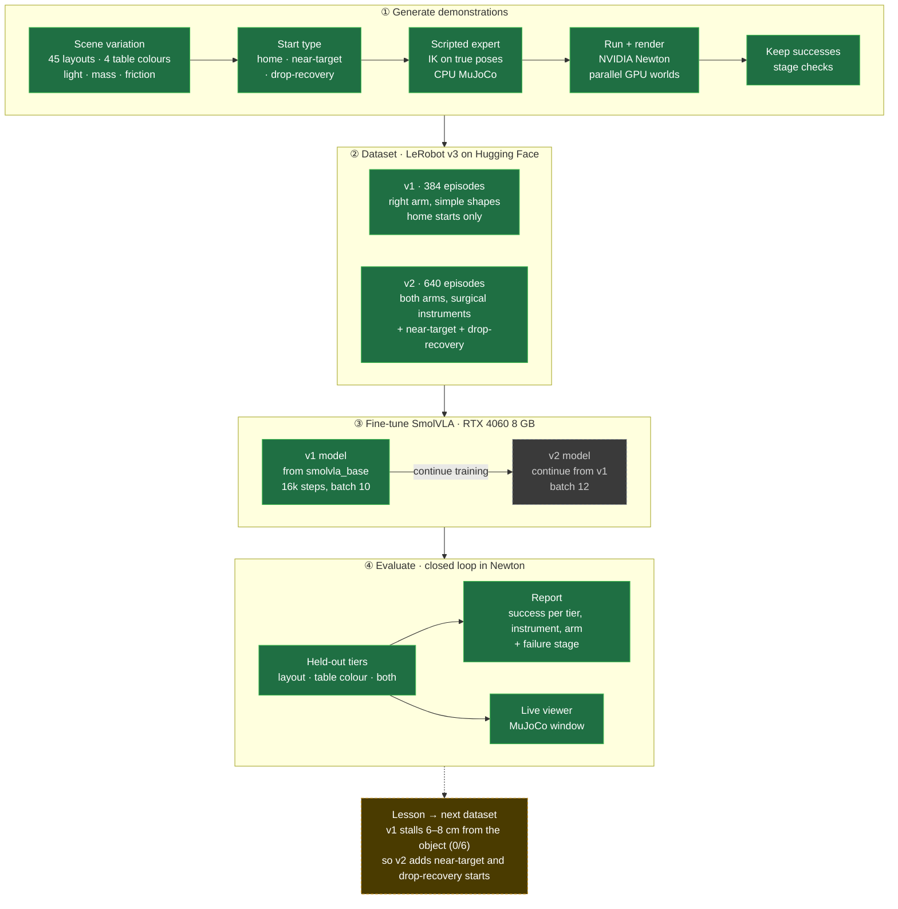
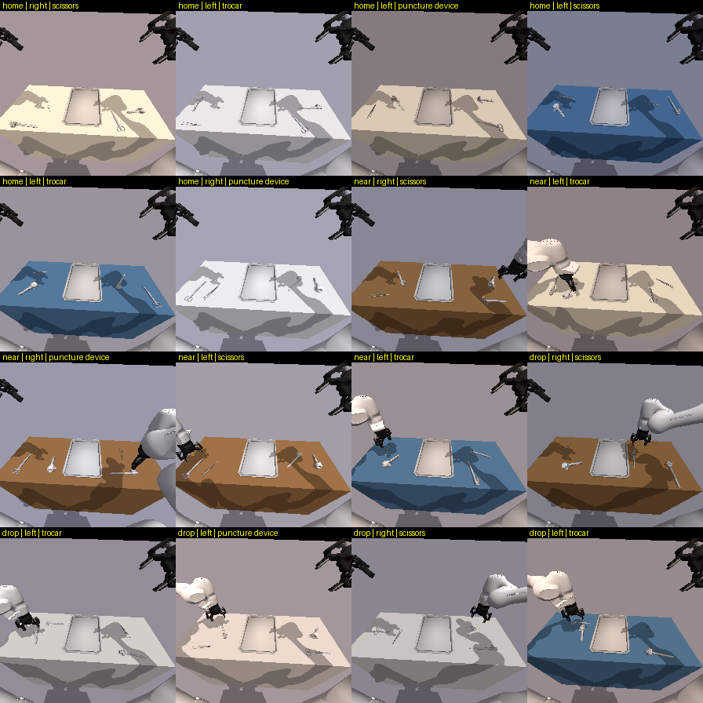

# Learning SmolVLA fine-tuning: how the dataset shapes the policy

A learning project: fine-tune a vision-language-action model ([SmolVLA](https://huggingface.co/lerobot/smolvla_base)) for a bimanual Franka FR3 Duo in a simulated cardiac cath lab, and study **how the training data (what it covers, how varied it is, which situations it shows) changes what the model can do**. The task is *"Hand me the `<instrument>`"*: pick the named instrument from the table and place it on the tray. Every demonstration is generated in simulation, so the dataset is a variable I can change and re-measure. Evaluation runs the policy closed-loop on scenes it never saw.



<sub>Green: built and run. Grey dashed: planned (v2 fine-tuning and its evaluation). Amber: what each evaluation changes in the next dataset.</sub>

### Dataset versions and what they taught

| Dataset | What changed | What the evaluation showed |
|---|---|---|
| **v1**: right arm, bottle / vial / syringe, 384 episodes, every episode starts at home | Baseline: simple shapes, one arm, a fixed start | SmolVLA (16k steps) gets its first actions right (0.02–0.04 rad from the expert) and approaches within 6–8 cm, then **stalls: 0/6 placements**. The data never shows the arm *near* the object, so small errors compound and the model has no example of how to correct them |
| **v2**: both arms, realistic surgical instruments, 640 episodes | Realistic meshes (scissors, trocar, puncture device; tweezers as clutter), the arm on the object's side picks, 45 layouts, and **recovery data**: 270 near-target starts and 100 starts after a dropped instrument | Built to test whether recovery examples fix the stall. **Fine-tuning and evaluation on v2 are the next step** |

Each later step gets its own row: what changed in the data, and the effect on held-out success.



*v2 first frames: home starts (rows 1–2), near-target starts, drop-recovery starts (row 4). Table colour, light, layout, acting arm and instrument vary per episode.*

## Datasets and models

| Dataset / model | Contents |
|---|---|
| [**aravindsuresh16/cathlab_fr3_newton_v1**](https://huggingface.co/datasets/aravindsuresh16/cathlab_fr3_newton_v1) | **Right-arm FR3 Duo, bottle / vial / syringe**, physics and rendering in Newton (MuJoCo-Warp). 384 episodes (159,568 frames) = one per cell of the train grid (3 objects × 8 layouts × 4 palettes × 4 table colours; held-out splits left out for evaluation). Per-episode config in `meta/episodes_extra.jsonl`, preview in `preview.gif` |
| [**aravindsuresh16/smolvla_cathlab_fr3_newton_v1**](https://huggingface.co/aravindsuresh16/smolvla_cathlab_fr3_newton_v1) (model) | SmolVLA fine-tuned on the dataset above (16k steps, batch 10, 2 h 19 min on an RTX 4060 laptop). Research checkpoint: reaches within 6–8 cm of the target, **0/6 placements** so far (see Status) |
| [**aravindsuresh16/cathlab_fr3_instruments_v1**](https://huggingface.co/datasets/aravindsuresh16/cathlab_fr3_instruments_v1) | **v2: both arms, surgical instruments** (NVIDIA Isaac for Healthcare / Lightwheel meshes), central tray. 640 episodes: 270 home starts, 270 near-target starts, 100 drop-recovery starts. 45 layouts, 4 table colours, light/mass/friction ranges; held-out layouts and colour left out for evaluation. **CC BY-NC 4.0** (non-commercial) because of the instrument assets |
| [aravindsuresh16/cathlab_handover_mujoco_v1](https://huggingface.co/datasets/aravindsuresh16/cathlab_handover_mujoco_v1) | Earlier MuJoCo track: left arm, 5 instruments, 200 episodes |

```python
from lerobot.datasets.lerobot_dataset import LeRobotDataset
ds = LeRobotDataset("aravindsuresh16/cathlab_fr3_newton_v1", revision="v1")
```

For quantile-normalized policies (π0.5), use `revision="v1.0.1"`: same episodes, but the idle left arm's `q01`/`q99` are widened so its sim jitter isn't amplified.

## Status

| Track | State | Details |
|---|---|---|
| Newton FR3 data (N1–N5) | ✅ Port, expert, variation, dataset and report done. Expert 100 % on train and all held-out tiers; CPU MuJoCo vs Newton agree on 60/60 episodes | [docs/NEWTON_REPORT.md](docs/NEWTON_REPORT.md) |
| SmolVLA on the Newton data | ⚠️ Trained (v1 model above). Inputs verified identical live vs training; first actions match the expert (0.02–0.04 rad). Closed loop it approaches to 6–8 cm, then stalls: no recovery examples in the data. Chunk-switch jitter fixed by blending (max jump 0.40 → 0.05 rad). Next: near-target start poses in the data, then continue training | `cathlab_sim/newton/watch.py`, `diag_policy.py` |
| v2: surgical instruments, both arms | ✅ Dataset published (above): expert 60/60 in Newton and CPU MuJoCo on every arm × instrument × start; 640 episodes incl. near-target and drop-recovery starts. ⏳ Fine-tuning and evaluation deferred (evaluation tool ready: `watch.py --task v2 --tiers ... --report`) | [docs/V2_PLAN.md](docs/V2_PLAN.md) |
| MuJoCo track (v1, left arm) | Superseded by the Newton track. Backend, expert (78 %), generator, eval harness | `cathlab_sim/` (top level) |

Throughput on this laptop (RTX 4060 8 GB, i9-14900HX), with cameras: Newton ~1,580 episodes/h at 32 worlds; CPU MuJoCo ~1,170/h per process, ~2,990/h with 12 processes. See the report.

## Layout

| Path | What it does |
|---|---|
| `cathlab_sim/newton/` | Newton track: task scenes (v1 right arm; v2 instruments, both arms: `instruments.py`), `NewtonTaskSim` (parallel worlds, batched cameras), CPU twin, shared stage checks, expert, generator, LeRobot converter, N1–N5 checks |
| `configs/variation/cathlab_fr3_newton.yaml` | Variation grid (team format): geometry, palettes, table colours, splits, mass/friction/light ranges |
| `cathlab_sim/` (top level) | MuJoCo track: robot model and 16-D mapping, scene, backend, IK, v1 expert, generator, evaluation, SmolVLA adapter, viewer |
| `docs/` | `NEWTON_REPORT.md` (Newton pipeline), `V2_PLAN.md` (current v2 work) |
| `reports/` | Check outputs and preview images |
| `tests/` | MuJoCo-track tests (schema, mapping, layouts, backend, stages) |

## Setup

Ubuntu 24.04, Python 3.12, NVIDIA GPU. Two virtual environments, because Newton needs MuJoCo 3.12 and LeRobot 0.6.1 is used with MuJoCo 3.3.7. Never install both into one env.

```bash
git clone --depth 1 https://github.com/google-deepmind/mujoco_menagerie external/mujoco_menagerie
python3.12 -m venv .venv && .venv/bin/pip install -r requirements.txt                       # MuJoCo track + LeRobot
python3.12 -m venv .venv-newton && .venv-newton/bin/pip install "newton[sim]==1.6.0" trimesh scipy pydantic pyyaml pillow pytest
python3.12 -m venv .venv-eval && .venv-eval/bin/pip install "newton[sim]==1.6.0" trimesh scipy pydantic pyyaml pillow "lerobot[dataset,av-dep,smolvla]==0.6.1"   # run a policy in Newton
```

ROS users: unset `PYTHONPATH` inside both venvs (ROS packages otherwise shadow the venv's).

## Run

Newton track (details and the rest of the commands in the report):

```bash
source .venv-newton/bin/activate
python -m cathlab_sim.newton.check_n1                 # Newton port checks
python -m cathlab_sim.newton.runner check             # expert success per object
python -m cathlab_sim.newton.runner generate --out datasets/newton_raw/v1 --count 384 --worlds 32
source .venv/bin/activate
python -m cathlab_sim.newton.convert --raw datasets/newton_raw/v1 --out datasets/cathlab_fr3_newton_v1
source .venv-eval/bin/activate
python -m cathlab_sim.newton.watch --ckpt aravindsuresh16/smolvla_cathlab_fr3_newton_v1   # live MuJoCo window, Newton physics
python -m cathlab_sim.newton.watch --expert                                                 # the scripted expert, for comparison
```

MuJoCo track:

```bash
source .venv/bin/activate
pytest -q tests
python -m cathlab_sim.generate --n 200 --out datasets/handover_v1
python -m cathlab_sim.evaluate --policy expert --n 60 --seed0 10000
python -m cathlab_sim.watch --episodes 5               # live viewer
```

## Credits

- Robot models: [MuJoCo Menagerie](https://github.com/google-deepmind/mujoco_menagerie) `franka_fr3_v2` and `robotiq_2f85` (licences in their folders).
- Physics and rendering: [Newton](https://github.com/newton-physics/newton), [MuJoCo](https://github.com/google-deepmind/mujoco) and [MuJoCo-Warp](https://github.com/google-deepmind/mujoco_warp) (Apache-2.0).
- `cathlab_sim/newton/variation.py`: copied unchanged from the team repo (Rakeshdharan/vla-cathlab-companion@9deeb21, `dataengine/variation.py`).
- v2 instrument and tray models: [NVIDIA Isaac for Healthcare asset catalog](https://github.com/isaac-for-healthcare/i4h-asset-catalog) (Lightwheel assets), **CC BY-NC 4.0** (non-commercial, attribution). Downloaded into `external/` (not in git).
- Meshes (not used): CC BY 4.0 from Sketchfab via Objaverse, see `assets/meshes/ATTRIBUTION.md`.
- Base model: [SmolVLA](https://huggingface.co/lerobot/smolvla_base) via [LeRobot](https://github.com/huggingface/lerobot).
- Approach inspired by [ContactPilot](https://github.com/VivekSai07/ContactPilot) and [franka-vla-generalization](https://github.com/VivekSai07/franka-vla-generalization); no code copied.
