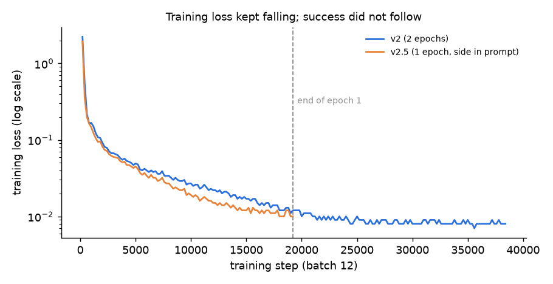
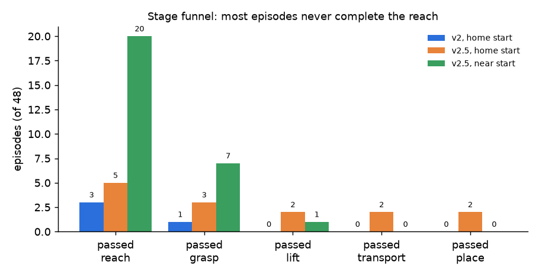
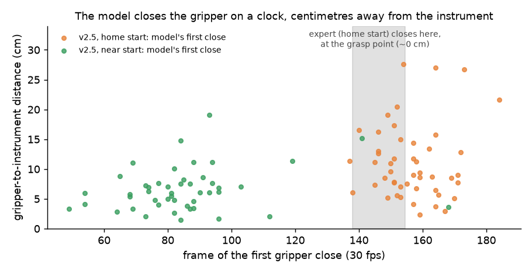

# v2 and v2.5: results and what they show

*Final write-up, 2026-10-31. The project is closed at this point. Plans and decisions from before training are in [V2_PLAN.md](V2_PLAN.md). Background on the model families is in [VLA_MODELS.md](VLA_MODELS.md).*

## In one paragraph

SmolVLA was fine-tuned from `lerobot/smolvla_base` on the 640-episode instrument dataset.

- **v2** (instructions as published): 0/48 on held-out scenes. The model always moved exactly one arm, but chose it at random (22/48 correct).
- **v2.5**: the same episodes with the acting arm written into the instruction ("… with the left arm"). This fixed the arm choice completely (48/48) and gave the project's first successes (**2/48**, both on held-out layouts).
- **What remains broken:** the reach. The model closes the gripper at roughly the time the expert does, but ~9 cm from the instrument.
- **Near-target starts don't fix it:** starting the arm 6–18 cm above the target, as in 270 training episodes, still gave 0/48, with the gripper closing ~6 cm off.

The model learned the *motion pattern* of a pick, but not to aim it at the instrument it sees.

## What was run

| Run | Data | Training | Final loss | Time |
|---|---|---|---|---|
| **v2** | `cathlab_fr3_instruments_v1`, 640 episodes, 9 instructions | From `smolvla_base`, batch 12, 38,400 steps (2 epochs), vision frozen | 0.008 | 6 h 41 min |
| **v2.5** | `cathlab_fr3_instruments_v2_5`: same frames, 18 instructions with the arm side | From `smolvla_base`, batch 12, 19,200 steps (1 epoch), vision frozen | 0.010 | 3 h 36 min |

Both were trained on an RTX 4060 Laptop (8 GB): 1.55–1.6 steps/s, 5.8 GB peak VRAM, no thermal throttling.

**Evaluation:**

- **Scenes:** 48 episodes per run: 4 test sets (in-distribution, held-out layout, held-out table colour, both held out) × 12 episodes, covering both arms and all three instruments.
- **Same scenes every time:** every run used the same seeds, so the rows below compare directly.
- **Success:** a stage tracker scores reach (< 5 cm), grasp, lift, transport and place; success means the instrument is placed on the tray.



*Loss fell smoothly in both runs. The second epoch of v2 lowered it further (0.012 → 0.008) without improving any evaluation number.*

## Results

| Run | Start | Prompt | Success | Correct arm | Closest approach, correct arm (median) | Failed at reach / grasp / lift / transport |
|---|---|---|---|---|---|---|
| v2, 1 epoch (19,200) | home | as trained | 0/48 | 25/48 | 13.4 cm | 44 / 4 / 0 / 0 |
| v2, 2 epochs (38,400) | home | as trained | 0/48 | 22/48 | 10.7 cm | 45 / 2 / 1 / 0 |
| v2, 2 epochs | home | side added (unseen words) | 0/48 | 25/48 | 14.4 cm | 45 / 3 / 0 / 0 |
| **v2.5** (19,200) | home | side in prompt | **2/48** | **48/48** | 9.1 cm (best 0.8 cm) | 43 / 2 / 1 / 0 |
| **v2.5** | **near target** | side in prompt | 0/48 | 48/48 | 5.4 cm | 28 / 13 / 6 / 1 |

Reports: `reports/v2_eval_019200.json`, `v2_eval_038400.json`, `v2_eval_038400_sideprompt.json`, `v2_5_eval_019200.json`, `v2_5_eval_019200_near.json`.

The two v2.5 successes were scissors (layout 45) and puncture device (layout 47), both left arm, both held-out layouts, each placed in ~14 s. A live replay of the same scenes did not repeat them. The policy samples its actions from noise, so at ~4 % success a repeat is unlikely.



## How the failure was narrowed down

1. **Arm choice was a coin flip.**
   - **Finding:** in every v2 episode exactly one arm moved (about 1.4 rad, against ~0.1 rad for the other arm), and it was the correct arm only about half the time. The ~50 cm "closest approach" numbers were wrong-arm episodes in which the measured arm never moved.
   - **Why:** the dataset never states the arm. The expert picks with the arm on the instrument's side (y > 0 → left), so the model would have had to find the named instrument in the image and infer its side. It didn't.
2. **The pipeline checks passed.** Before blaming the model, these were verified:
   - **Camera mapping:** the checkpoint's own processor renames the cameras exactly as in training.
   - **State:** all 16 state values reach the model, normalised (the "6" in the config is base-model metadata and is unused).
   - **Contact settings:** the evaluation sim uses the elliptic friction cone and impratio 10, like data generation. The attach warning is harmless.
3. **Unseen words are ignored.** Adding "with the left/right arm" to the v2 prompt at test time changed nothing (25/48), because the model had never seen those words.
4. **Trained with the side, the arm choice is solved.** The v2.5 dataset only rewrites the instruction text: 640/640 recorded sides matched the arm that moves, and all images, states and actions are identical. Result: 48/48 correct arm.
5. **The gripper closes on a clock.**
   - **Expert:** in home-start demos it first closes the gripper at frame 145 (5th–95th percentile 138–155), at the grasp point.
   - **v2.5 model:** it closes at frame 156, median **9.2 cm** from the instrument, and does so in 48/48 episodes, wherever the arm is.
   - **Interpretation:** the model follows the usual timing and an average reach. It does not aim at the instrument in the image.
6. **Starting near the target doesn't help.** From 6–18 cm above the instrument, the setting of 270 training episodes, the gripper still closes about 6 cm off. Fourteen episodes reached grasp or lift and then lost the instrument. The close-up wrist view isn't being used for fine positioning either.



## Why this probably happens

These explanations fit the data but weren't proven.

- **The shortcut is easier than looking.**
  - **Easy signal:** the arm's own joint angles tell the model how far along the motion it is, which is enough to predict "close now".
  - **Hard signal:** the instrument's exact position has to come from ~25 px grey shapes in a 224 px overhead image, through a *frozen* vision encoder.
  - **Result:** training loss rewards whatever predicts the expert's actions, and "follow the usual motion" gets most of the way.
- **Instruments look alike.** Newton drops textures, so each instrument renders as one flat colour. In the overhead view the scissors and puncture device are hard to tell apart even for a person.
- **Long open-loop chunks.** 25 actions (0.8 s) run between observations, which leaves little room to correct.
- **A known weakness of the model.** A 2026 study found grasping skill and instruction following "decoupled" in SmolVLA and π0.5 when several objects are present ([*Robust Skills, Brittle Grounding*](https://arxiv.org/abs/2602.24143)). Our runs show the same pattern.

**Not ruled out:** a hidden mismatch between training and evaluation that garbles what the model sees. The test that would settle it was not run: overfit on 5 episodes, then replay exactly those 5 scenes.

## Lessons

1. **Training loss says nothing about success here.** Loss fell to 0.008–0.010 while success stayed at 0–4 %. Judge checkpoints with a short closed-loop test (12 episodes, ~3 min), not loss.
2. **Diagnose with traces, not just success rates.** Per-frame traces (distance, actions, stage flags) turned "0/48" into three separate problems: arm choice, reach and timing. They also showed which fix worked.
3. **A policy can only use words it was trained on.** Information the expert uses (here, which arm) has to appear in the model's inputs during training.
4. **Run the cheapest test that tells hypotheses apart first.** The overfit test should have come before the long v2 run.
5. **On 8 GB, the model choice is limited.** Only SmolVLA-size models (and non-language policies such as ACT) fit for fine-tuning. See [VLA_MODELS.md](VLA_MODELS.md).

## Where it was left

| Option | Status |
|---|---|
| Overfit test (pipeline bug vs model limit) | Not run |
| Detector + planner + SmolVLA for the final grasp ("Plan B") | Ruled out for this model by the near-start result |
| Classical pipeline: detector (rotated boxes) + planner + scripted grasp | Not built. Likely to work; no learned policy |
| Single arm, one instrument per scene | Not tried |

## Published

| What | Where |
|---|---|
| v2.5 dataset (arm side in the instruction) | [aravindsuresh16/cathlab_fr3_instruments_v2_5](https://huggingface.co/datasets/aravindsuresh16/cathlab_fr3_instruments_v2_5) |
| v2.5 model (research checkpoint, 2/48) | [aravindsuresh16/smolvla_cathlab_fr3_instruments_v2_5](https://huggingface.co/aravindsuresh16/smolvla_cathlab_fr3_instruments_v2_5) |

The v2 checkpoints (0/48) were not published.

## Reproduce

```bash
# v2.5 dataset from the published v2 dataset (instruction text only; videos hard-linked)
source .venv/bin/activate
python tools/relabel_side.py datasets/cathlab_fr3_instruments_v1 datasets/cathlab_fr3_instruments_v2_5

# train (1 epoch at batch 12, ~3.5 h on an RTX 4060 Laptop)
lerobot-train --policy.path=lerobot/smolvla_base --policy.device=cuda --policy.push_to_hub=false \
  --dataset.repo_id=aravindsuresh16/cathlab_fr3_instruments_v2_5 --dataset.root=datasets/cathlab_fr3_instruments_v2_5 \
  --rename_map='{"observation.images.external_camera":"observation.images.camera1","observation.images.left_wrist_camera":"observation.images.camera2","observation.images.right_wrist_camera":"observation.images.camera3"}' \
  --batch_size=12 --steps=19200 --save_freq=4800 --log_freq=200 --wandb.enable=false --output_dir=outputs/smolvla_v2_5

# evaluate (add --near-start for the near-target test; drop --no-viewer to watch)
source .venv-eval/bin/activate
python -m cathlab_sim.newton.watch --task v2 --side-in-prompt \
  --ckpt aravindsuresh16/smolvla_cathlab_fr3_instruments_v2_5 --no-viewer --episodes 12 \
  --tiers in_distribution held_out_layout held_out_table_color all_held_out \
  --report reports/eval.json --trace outputs/eval_traces/eval.npz

# plots in this file
python tools/plot_v2_results.py
```

Keep browsers closed while training: on this laptop an open browser window slowed training by ~25 %.
